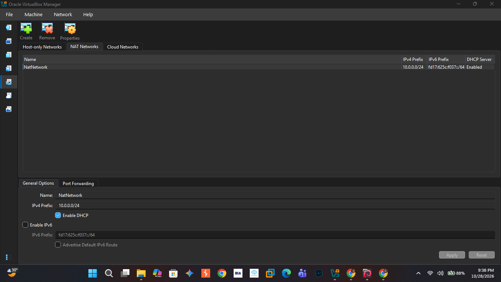
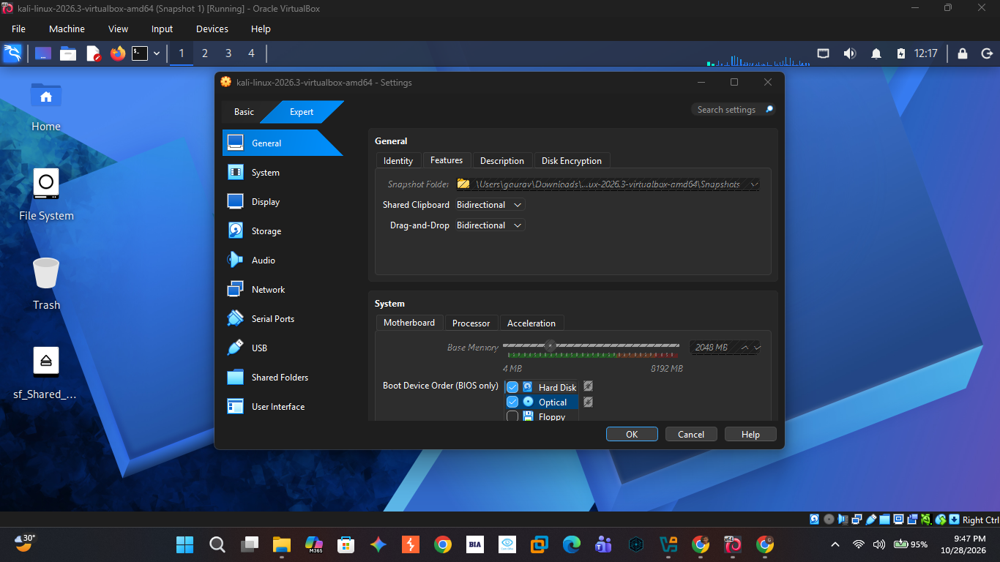
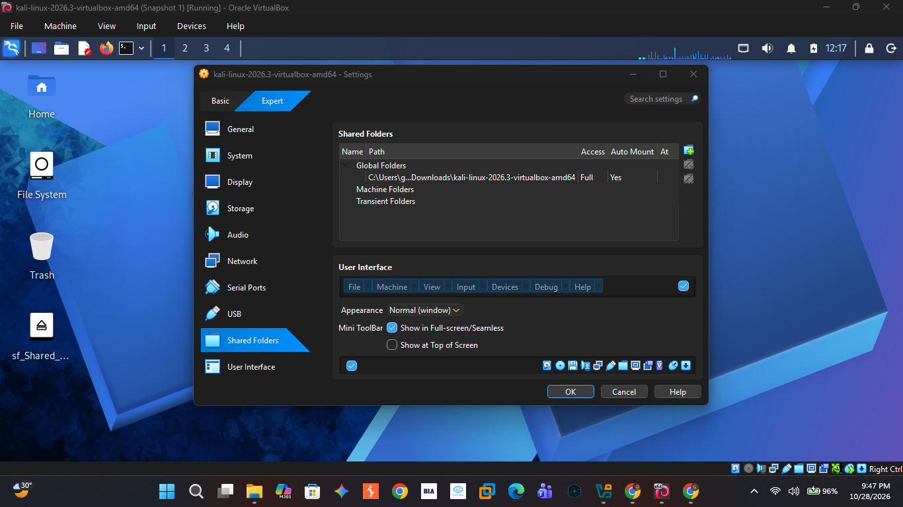
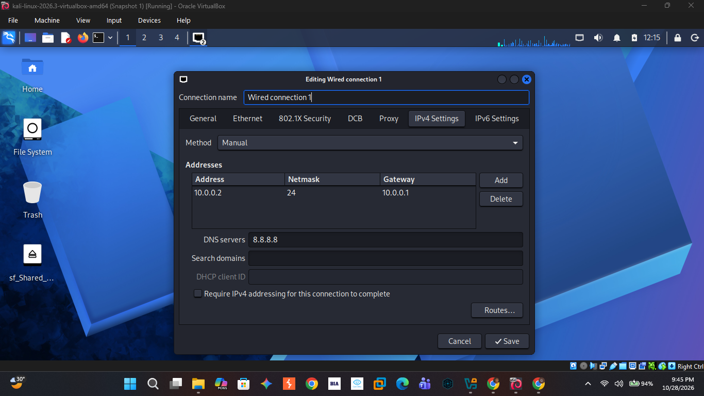
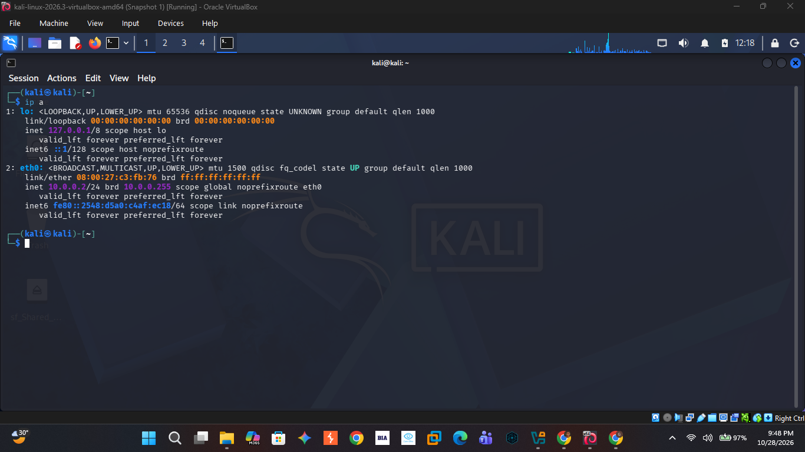
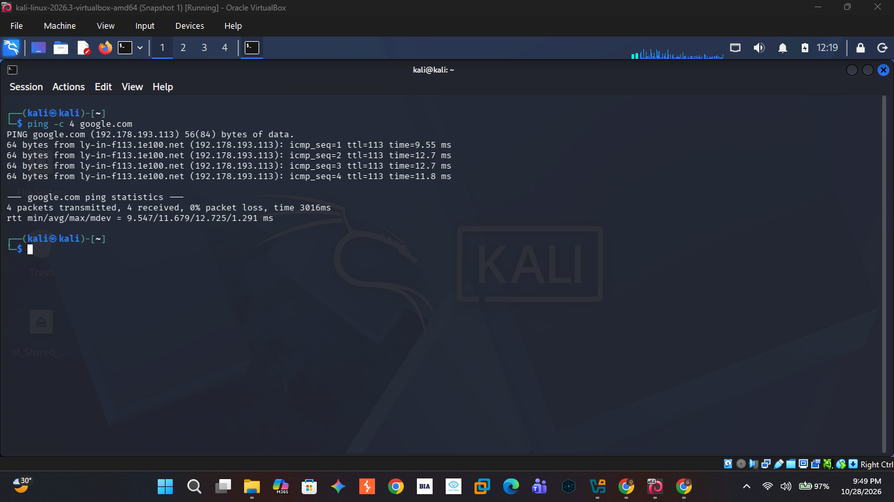

<h1 align="center">🔐 Kali Linux Attacker Machine Setup</h1>

<p align="center"><b>Building an isolated virtual lab for penetration testing and ethical hacking practice</b></p>

<p align="center">
  
  
  
  
  
  
  
</p>

---

## 📌 Project Overview

This project focuses on setting up a **virtual penetration-testing laboratory** using VirtualBox and Kali Linux.

Kali Linux is configured as the attacking (hacker) machine on a private NAT Network with a static IP address, shared clipboard, drag & drop, a shared folder with the host, and full Internet access.

The lab is configured on a private virtual network so that additional machines can be added later and used as targets for authorized security testing.

---

## 🎯 Objectives

The main objectives of this project are to:

- Use VirtualBox (latest recommended version) as the hypervisor.
- Set up Kali Linux as the attacking/hacker machine.
- Create a private **NAT Network** using the subnet `10.0.0.0/24`.
- Enable bidirectional clipboard and drag & drop between the host and the VM.
- Enable a shared folder from the host machine's Downloads directory.
- Assign the static IP address `10.0.0.2/24` to Kali Linux.
- Verify full Internet access from the Kali VM.
- Document the complete setup process with screenshots.

---

## 🛡️ Purpose of the Lab

The lab provides an isolated and controlled environment for cybersecurity learning and authorized security testing.

It can be used for activities such as:

- Network reconnaissance
- Port scanning
- Vulnerability assessment
- Packet analysis
- Web security testing
- Security-tool experimentation

⚠️ **Important:** This laboratory must only be used on systems that you own or have explicit permission to test. Do not use the lab or its tools to attack unauthorized systems.

---

## 🏗️ Lab Architecture

```text
              Host Machine (Windows)
                       │
                   VirtualBox
                       │
        NAT Network "NatNetwork": 10.0.0.0/24
                Gateway: 10.0.0.1
                       │
          ┌────────────┴────────────┐
          │     Kali Linux VM       │
          │   10.0.0.2/24 (static)  │
          └────────────┬────────────┘
                       │
                Internet (via NAT)
```

Additional target machines can be added to the same virtual network in future projects.

---

## ⚙️ Lab Configuration

| 🧩 Component | ⚙️ Configuration |
|---|---|
| 🖥️ Host OS | Windows |
| 🧰 Hypervisor | VirtualBox (latest recommended version) |
| 🐉 Security OS | Kali Linux 2026.3 |
| 🎯 Role | Attacker / hacker machine |
| 🧠 Kali RAM | 2048 MB |
| 🌐 Virtual Network | NAT Network (`NatNetwork`) |
| 📡 Network Address | 10.0.0.0/24 |
| 🐧 Kali IP Address | 10.0.0.2/24 (manual / static) |
| 🚪 Default Gateway | 10.0.0.1 |
| 🌍 DNS Server | 8.8.8.8 |
| 📋 Shared Clipboard | Bidirectional |
| 🖱️ Drag & Drop | Bidirectional |
| 📁 Shared Folder | Host Downloads folder (Full access, Auto-mount) |
| 🌐 Internet Access | Full |

---

## 🪜 Lab Setup Procedure

### Step 1. Install VirtualBox

The latest recommended version of VirtualBox was installed as the hypervisor.

---

### Step 2. Create the NAT Network

A dedicated NAT Network was created in VirtualBox.

**Configuration:**

```text
Network Name: NatNetwork
IPv4 Prefix:  10.0.0.0/24
DHCP:         Enabled
IPv6:         Disabled
```



A NAT Network was selected because multiple virtual machines connected to the same NAT Network can communicate with one another while also having outbound Internet connectivity. This allows future attacker and target VMs to communicate within the lab.

---

### Step 3. Set Up Kali Linux and Attach It to the NAT Network

Kali Linux was set up as a virtual machine in VirtualBox, and its network adapter was attached to the NAT Network.

```text
Adapter 1
Attached to: NAT Network
Network:     NatNetwork
```

---

### Step 4. Enable Clipboard and Drag & Drop

In the VM settings under **General → Features**, both options were set to **Bidirectional**:

```text
Shared Clipboard: Bidirectional
Drag-and-Drop:    Bidirectional
```



---

### Step 5. Configure the Shared Folder

In **Settings → Shared Folders**, the host machine's Downloads folder was added with the following options:

```text
Access:     Full
Auto Mount: Yes
```

The shared folder appears inside Kali Linux on the desktop as an `sf_` folder, which makes it easy to move files between the host and the VM.



---

### Step 6. Configure the Kali Linux Network

A static IPv4 address was configured in the Kali network settings (**Edit Connections → IPv4 Settings**):

```text
Method:       Manual
IP Address:   10.0.0.2
Netmask:      24 (255.255.255.0)
Gateway:      10.0.0.1
DNS:          8.8.8.8
```

A consistent IP address makes it easier to document the lab and reference the Kali machine in future exercises.



---

## 🔎 Lab Verification

| ✅ Test | 🧾 Command | 🎯 Result |
|---|---|---|
| 🌐 Check IP address | `ip a` | `10.0.0.2/24` displayed on `eth0` |
| 🌍 Test Internet and DNS | `ping -c 4 google.com` | 4 packets sent, 4 received, 0% packet loss |

### Kali IP Address



### Internet Access Test



### Verification Checklist

- [x] Kali Linux shows the IP address `10.0.0.2/24`
- [x] Internet is reachable and DNS resolves (`ping google.com`)
- [x] Shared clipboard is set to Bidirectional
- [x] Drag & drop is set to Bidirectional
- [x] Shared folder is configured and mounted in Kali

---

## 🐞 Problems Encountered & Solutions

### Problem 1. No Internet Connectivity After Static IP Configuration

After I manually configured the IPv4 settings (`10.0.0.2/24`, gateway `10.0.0.1`, DNS `8.8.8.8`), the Kali VM did not have working Internet connectivity.

**Solution:** I disabled the duplicate address detection (DAD) timeout on the connection using NetworkManager:

```bash
sudo nmcli connection modify "Wired connection 1" ipv4.dad-timeout 0
```

I then restarted the network connection (or rebooted the VM) and tested connectivity again with `ping -c 4 google.com`. After this, the Internet worked.

> **Note:** Connection names may differ between systems. Run `nmcli connection show` first to find your actual connection name before using the command.

---

## 💡 What I Learned

### 1. NAT Network

A NAT Network lets multiple VMs on the same virtual network communicate with each other while still having outbound Internet access, which makes it suitable for a multi-machine cybersecurity lab.

### 2. Virtual Machine Networking

I learned how VirtualBox network adapters connect virtual machines to a network and how the network settings affect communication between machines.

### 3. Static IP Configuration

I learned how to configure and verify the IPv4 address, subnet mask, gateway, and DNS settings in Kali Linux.

### 4. Host and VM Integration

I learned how to enable the shared clipboard, drag & drop, and shared folders to move data between the host and the VM.

### 5. Documentation

I learned that documenting configuration, commands, and screenshots is an important part of a professional cybersecurity project.

---

## 🔐 Security & Ethical Use

This laboratory is intended strictly for educational purposes and authorized security testing only.

---

## 🔗 Tools & Resources

- **VirtualBox:** https://www.virtualbox.org/wiki/Downloads
- **Kali Linux:** https://www.kali.org/get-kali/

---

## 👤 Author

**Gaurav Kudiya**
Cybersecurity Student, NetworkWalks B084M

LinkedIn: https://www.linkedin.com/in/gauravkudiya/

---

## 📌 Project Information

**Program Name:** Cybersecurity at Networkwalks | **Batch:** B084M | **Week:** 01 | **Project:** PM1 – Lab Setup | **Repository:** GitHub
